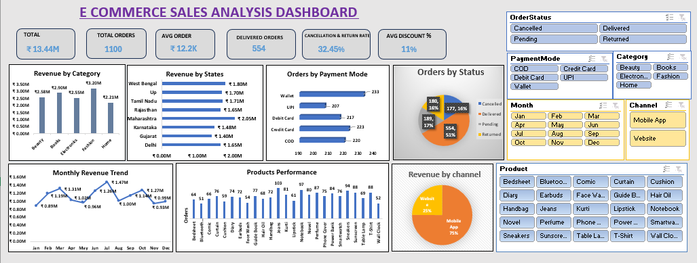

# E-Commerce Sales Analysis Dashboard

## Project Overview

This project analyzes e-commerce sales performance using Microsoft Excel to uncover trends in revenue, orders, customer behavior, payment preferences, and return patterns.

The dashboard provides actionable business insights through KPI tracking, interactive visualizations, pivot table analysis, and dynamic slicers.

---

## Dashboard Preview



---

## Business Objective

The objective of this project was to:

- Monitor overall sales performance
- Identify top-performing product categories
- Analyze revenue contribution by state
- Evaluate channel performance
- Understand customer payment behavior
- Track returns and cancellations
- Generate business recommendations based on data

---

## Dataset Information

The dataset contains 1,100 orders across multiple product categories, states, and payment channels.

### Key Fields

| Column | Description |
|----------|-------------|
| Order ID | Unique Order Identifier |
| Order Date | Date of Order |
| Category | Product Category |
| Product | Product Name |
| State | Customer State |
| Quantity | Quantity Ordered |
| Unit Price | Product Unit Price |
| Discount % | Applied Discount |
| Order Status | Delivered, Returned, Cancelled, Pending |
| Payment Mode | COD, UPI, Debit Card, Credit Card, Wallet |
| Channel | Mobile App or Website |
| Order Amount | Net Order Value |

---

## Dashboard KPIs

| KPI | Value |
|-------|--------|
| Total Revenue | ₹13.44M |
| Total Orders | 1,100 |
| Average Order Value | ₹12.2K |
| Delivered Orders | 554 |
| Return & Cancellation Rate | 32.45% |
| Average Discount | 11% |

---

## Tools & Techniques Used

### Microsoft Excel

- Pivot Tables
- Pivot Charts
- Slicers
- Conditional Logic
- XLOOKUP
- INDEX + MATCH
- SUMIF
- COUNTIF
- Data Visualization

### Data Analysis

- Revenue Analysis
- Category Performance
- State Performance
- Channel Analysis
- Payment Analysis
- Return Analysis
- KPI Reporting

---

## Key Business Insights

### 1. Fashion Generates Highest Revenue

Fashion is the highest revenue-generating category, contributing approximately ₹3.2M in sales.

### 2. High Return & Cancellation Rate

The overall return and cancellation rate is 32.45%, meaning nearly one-third of all orders do not result in a successful sale.

### 3. Books Have Highest Returned Value

Books generated the highest returned/cancelled sales value, followed by Beauty products.

### 4. Mobile App Dominates Sales

The Mobile App generated approximately ₹10.1M in sales and accounted for 75% of all orders.

### 5. Maharashtra Leads Revenue

Maharashtra is the top-performing state with ₹2.05M in revenue.

### 6. COD Orders Show Higher Risk

23% of all returned orders originated from COD transactions, indicating a relatively higher return probability.

### 7. Seasonal Revenue Peaks

July recorded the highest monthly revenue, making it the strongest-performing month.

### 8. Books Drive Volume While Fashion Drives Revenue

Books received the largest number of orders, while Fashion generated the highest revenue.

---

## Business Recommendations

- Promote prepaid payment methods to reduce COD-related returns.
- Investigate return causes within the Books and Beauty categories.
- Increase inventory investment in Fashion products.
- Focus customer acquisition efforts on Mobile App users.
- Expand targeted campaigns in Maharashtra and West Bengal.
- Prepare inventory and marketing budgets for peak sales months.

---

## Repository Structure

```text
e-commerce-sales-analysis-dashboard
│
├── README.md
│
├── data
│   └── E-commerce_Raw_Data.xlsx
│
├── dashboard
│   └── E-Commerce sales analysis report.xlsx
│
├── screenshots
│   └── dashboard-overview.png
│
├── documentation
│   ├── project_summary.md
│   ├── business_insights.md
│   └── dashboard_metrics.md
```

---

## Author

Ayush Mishra

Aspiring Data Analyst

LinkedIn: linkedin.com/in/ayush-mishra-941512268

GitHub: github.com/ayush-data-analyst